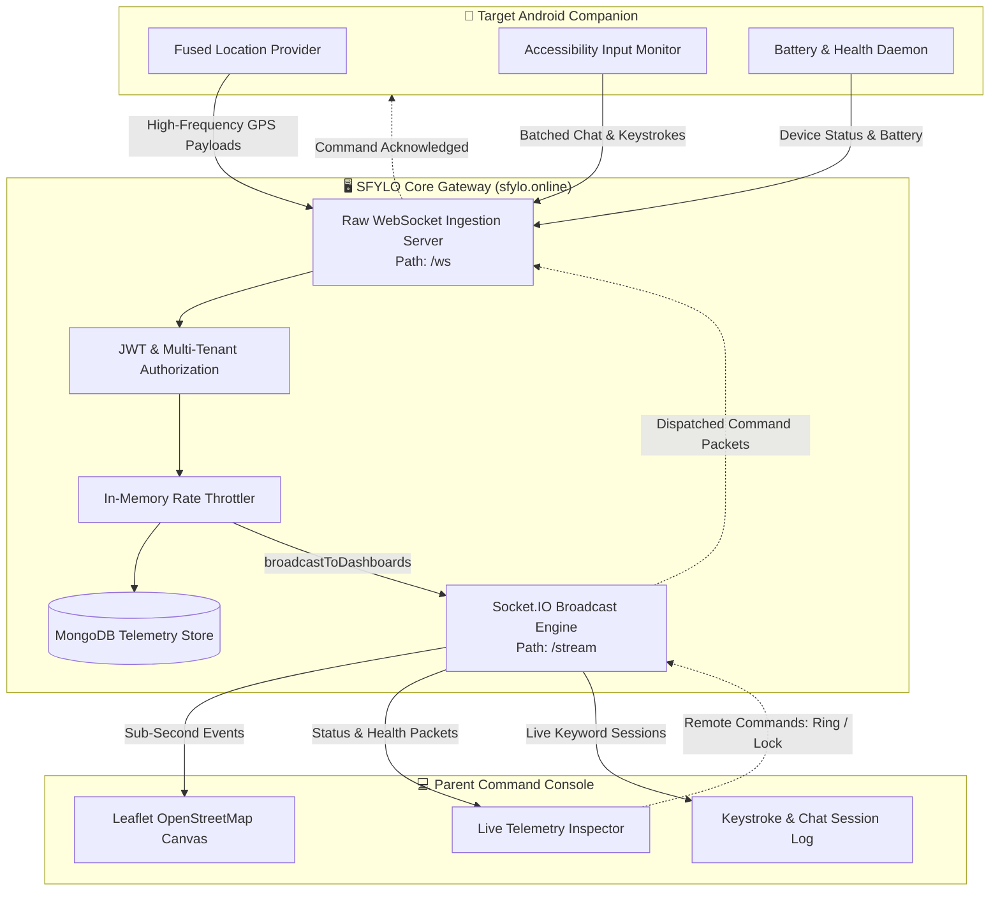

# 📐 System Architecture: SFYLO Platform Topology

<p align="center">
  <a href="https://sfylo.online"></a>
  
  
</p>

---

## 🏛️ Architectural Principles

The SFYLO engineering architecture is guided by five core operational tenets:

1. **Sub-Second Telemetry Through Event Push**: Eliminates traditional HTTP polling in favor of persistent bi-directional WebSocket connections, reducing latency to under 50ms.
2. **Strict Multi-Tenant Isolation**: Every telemetry point, keystroke session, and device command is scoped to authenticated parent accounts with cryptographically enforced access barriers.
3. **Low-Power Mobile Footprint**: Employs fused location providers with dynamic velocity-based distance filters to prevent battery drain on the target hardware.
4. **Stealth Resilience & Self-Healing**: Mobile daemons maintain self-recovering socket loops with exponential jitter backoff, ensuring immediate reconnection upon network changes.
5. **No Proprietary Vulnerability Exposure**: System components interact through clean public abstractions, preventing reverse-engineering or unauthorized cloning of client services.

---

## 🔄 Dual-Channel Ingestion & Broadcast Architecture

SFYLO decouples high-frequency mobile telemetry ingestion from parent web console delivery using a dedicated dual-pipeline streaming design:



---

## 🔑 Ephemeral Handshake Pairing Protocol

Device association in SFYLO is designed to be frictionless for parents while strictly eliminating credential sharing on the child's device:

```
PARENT CONSOLE (Browser)              SFYLO API CLUSTER              TARGET HARDWARE (App)
       │                                     │                                 │
       │─── 1. POST /api/devices/pairing ───>│                                 │
       │    (Authenticated Session)          │                                 │
       │                                     │                                 │
       │<── 2. Returns SF-XXXX (TTL: 15m) ───│                                 │
       │    (Displays 6-digit PIN on HUD)    │                                 │
       │                                     │                                 │
       │                                     │<── 3. POST /api/device/activate │
       │                                     │    (Code + Device ID + Model)   │
       │                                     │                                 │
       │                                     │─── 4. Verify Code & Link ───────│
       │                                     │    (Pins Hardware to Account)   │
       │                                     │                                 │
       │<── 5. WS 'device_paired' Event ─────│                                 │
       │    (HUD Auto-Selects Device)        │                                 │
       │                                     │─── 6. Handshake Complete ──────>│
       │                                     │    (Enables Stealth Mode)       │
```

### Key Security Attributes of the Pairing Flow:
- **Zero Account Credentials on Child Device**: The child's phone never receives the parent's email, master password, or payment details.
- **Automated TTL Invalidation**: Handshake codes auto-expire in 15 minutes via MongoDB time-to-live indexes.
- **Offline Device Recycling**: If an old device is permanently retired or offline, the pairing manager permits immediate replacement without administrative locks.

---

## 💾 Core Domain Entity Models (High-Level)

The persistence layer separates fast-moving operational telemetry from long-term user ownership records:

| Entity Collection | Primary Attributes | Retention & Storage Policy |
|---|---|---|
| **Users** | Account credentials (Argon2id), active license tier, linked device identifiers, account creation timestamp. | Persistent, encrypted at rest. |
| **Devices** | Hardware ID, model, OS version, battery percentage, active online status, last ping timestamp. | Continuously updated in-place via socket heartbeats. |
| **Locations** | Geocoordinates (latitude, longitude), speed, GPS bearing, accuracy radius (meters), timestamp. | Indexed by `deviceId` and `timestamp` for sub-second trajectory reconstruction. |
| **KeywordSessions** | Target application package, application display name, captured keystroke text content, timestamp. | Indexed for fast per-application filtering across WhatsApp, Instagram, Messenger, and browsers. |
| **PairingCodes** | Ephemeral 6-digit handshake code, target user ID, creation timestamp. | Automatic deletion upon activation or 15-minute TTL expiration. |

---

## 🌐 Network Security & Firewall Topography

1. **Strict Transport Security (TLS 1.3)**: All web and WebSocket endpoints mandate modern encryption ciphers.
2. **Reverse Proxy Architecture**: Production traffic routes through a reverse proxy terminating SSL, performing HTTP request sanitation, and enforcing DDoS rate limits.
3. **LAN & Cloud Multi-Homing**: Supports seamless failover between local test subnets (`192.168.x.x`, `10.x.x.x`) and live cloud production hosts (`sfylo.online`).

---

<p align="center">
  <a href="https://sfylo.online"><strong>Explore the Live Platform at sfylo.online →</strong></a>
</p>
