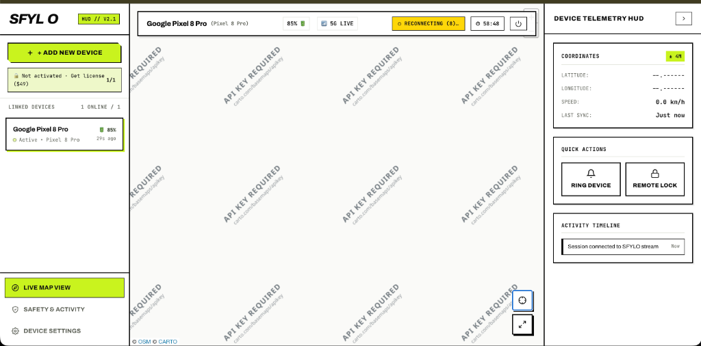
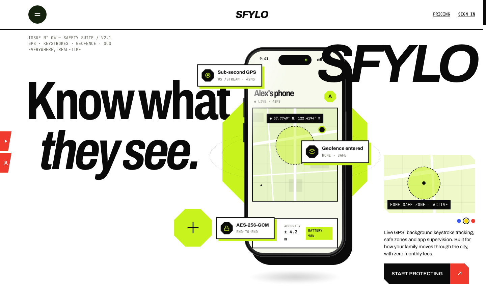
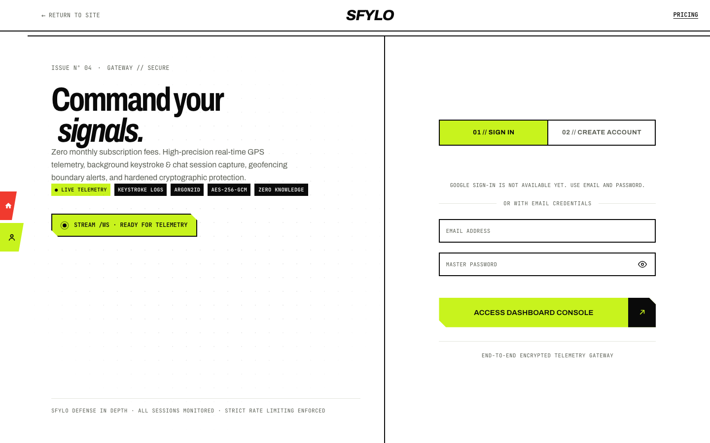
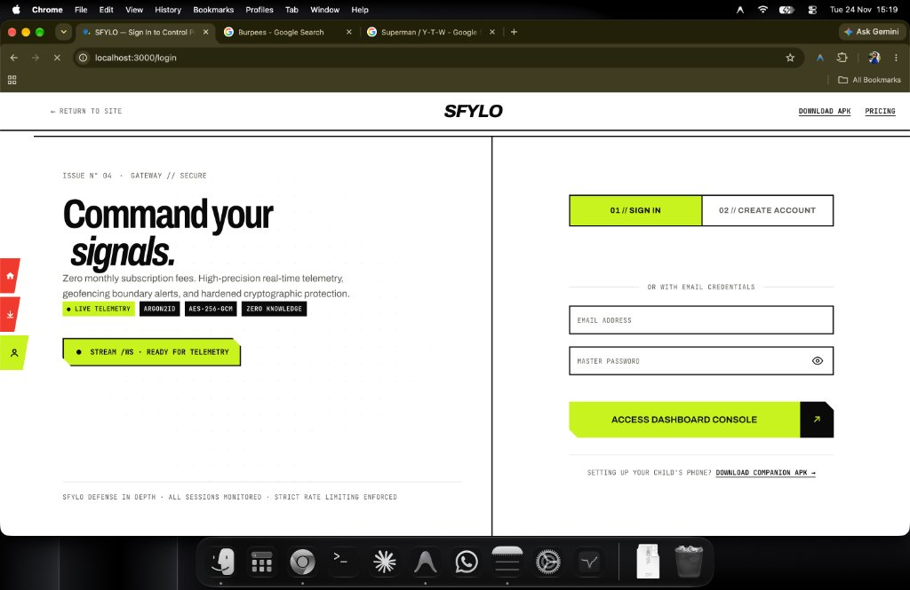

# 🛡️ SFYLO: Next-Gen Stealth Mobile Telemetry & Family Protection Platform

<p align="center">
  
</p>

<p align="center">
  <a href="https://sfylo.online"></a>
  <a href="https://github.com/monithishanka/SFYLO"></a>
  
  
  
</p>

<p align="center">
  <strong>The Official Architecture & Platform Overview for SFYLO</strong><br/>
  An institutional-grade child safety and mobile telemetry ecosystem delivering real-time location precision, live keystroke and chat intelligence, boundary geofencing alerts, and remote device supervision with zero recurring subscription fees.
</p>

---

## 📌 Repository Purpose

This repository provides the high-level **system architecture, visual previews, operational workflows, and security overview** for the [SFYLO Platform (sfylo.online)](https://sfylo.online).

To protect platform integrity and prevent unauthorized reproduction of proprietary stealth telemetry techniques, this repository focuses on **architectural concepts, component topologies, technology choices, and capabilities** rather than raw underlying source code.

---

## 📑 Overview Index

| Document | Description |
|---|---|
| 📐 [**ARCHITECTURE.md**](ARCHITECTURE.md) | High-level system topology, micro-service data flow, WebSocket pipelines, and technology stack. |
| 🚀 [**FEATURES.md**](FEATURES.md) | Comprehensive overview of platform capabilities, parental supervision features, and telemetry intelligence. |
| 🔄 [**WORKFLOWS.md**](WORKFLOWS.md) | End-to-end operational lifecycles: pairing handshakes, real-time GPS streaming, geofencing, and remote commands. |
| 🛡️ [**SECURITY_AND_COMPLIANCE.md**](SECURITY_AND_COMPLIANCE.md) | Multi-tenant isolation, cryptographic primitives, rate-limiting defenses, and zero-knowledge storage models. |

---

## ⚡ Executive Summary: Modern Family Safety

Modern parents face unprecedented digital safety challenges: children navigate complex digital ecosystems, unverified sideloaded applications, untracked locations, and unmonitored communication channels. Conventional parental control software suffers from three critical flaws:

1. **Predatory Subscription Pricing**: Families are locked into high monthly fees that cost hundreds of dollars over time.
2. **Lagging Telemetry & Battery Drain**: Inefficient polling mechanisms report stale location data while draining the child's device battery.
3. **Fragile Visibility**: Standard applications are easily uninstalled, disabled, or bypassed by target devices.

**SFYLO** resolves these structural flaws through a high-performance, single-license architecture built with modern WebSocket event streaming, sub-second GPS mapping, stealth background daemon reliability, and cryptographically verified command dispatching.

---

## 🏗️ High-Level Ecosystem Topology

```
┌────────────────────────────────────────────────────────────────────────┐
│                        PARENT COMMAND CONSOLE                          │
│        (Responsive Web App • Mobile / Tablet / Desktop / Mac)          │
│   • Live OpenStreetMap Vector HUD     • Keystroke Intelligence Feed    │
│   • Geofence Perimeter Manager        • Remote Security Lock & Ring    │
└───────────────────────────────────┬────────────────────────────────────┘
                                    │
                       TLS 1.3 / WebSocket (/stream)
                                    ▼
┌────────────────────────────────────────────────────────────────────────┐
│                        SFYLO CORE API CLUSTER                          │
│   • Bi-directional Event Dispatcher   • Multi-Tenant Account Isolation │
│   • Ephemeral Handshake Manager       • In-Memory Telemetry Throttle   │
│   • Crypto Payment Engine (NOWPayments) • Geofence Proximity Evaluator │
└──────────────────┬─────────────────────────────────┬───────────────────┘
                   │                                 │
         Persistent Raw WS (/ws)             MongoDB Cluster
                   │                   (Encrypted Telemetry Storage)
                   ▼
┌────────────────────────────────────────────────────────────────────────┐
│                       MANAGED TARGET COMPANION                         │
│                    (Optimized Android Service)                         │
│   • Passive & High-Accuracy GPS Hub   • Background Keystroke Monitor   │
│   • Social Chat Session Listener      • Stealth Service Daemon         │
│   • Emergency Audio Pulse Streamer    • Dynamic App Install Shield     │
└────────────────────────────────────────────────────────────────────────┘
```

---

## 🛠️ Technology Stack Matrix

| Domain | Technologies & Frameworks | Strategic Purpose |
|---|---|---|
| **Web Console UI** | Vanilla ES Modules, Vite 8, Tailwind CSS, Leaflet | Ultra-lightweight footprint, instant zero-latency loading, high-frame-rate Leaflet GPS canvas rendering. |
| **Design Language** | Editorial "Street Grid", Archivo, JetBrains Mono | High-contrast visual hierarchy, chamfered HUD geometry, immediate status recognition under sunlight. |
| **Backend Core** | Node.js, Express, Socket.IO, Raw WebSockets | Dual-channel streaming: raw socket ingestion for mobile clients and multiplexed rooms for browser consoles. |
| **Persistence** | MongoDB Cluster, Mongoose ODM | Document-oriented telemetry storage with automated TTL expiration for ephemeral pairing tokens. |
| **Mobile Runtime** | Native Android SDK (Java/Kotlin), Support for API 26–35 | Native OS background reliability, ultra-low power consumption, self-healing service lifecycle. |
| **Security & Auth** | Argon2id, JWT, AES-256-GCM, Rate-Limiting Engine | Cryptographically hardened password verification, tamper-resistant tokens, multi-tenant isolation. |
| **Commercial Core** | NOWPayments Cryptocurrency API | Non-custodial, subscription-free one-time lifetime license verification with automated instant activation. |

---

## 📸 Visual Interface Gallery

### 1. Operations Command Center (Live Map & Device Telemetry)
The central parent HUD displays real-time coordinates, battery level, network telemetry, quick actions (Ring Device, Remote Lock), and live activity streams.
<p align="center">
  
</p>

### 2. Marketing & Platform Gateway (sfylo.online)
The high-fashion editorial landing page communicates core capabilities, live GPS trials, interactive telemetry sandbox, and transparent lifetime pricing.
<p align="center">
  
</p>

### 3. Secure Gateway & Authentication Portal
Zero-knowledge authentication viewport featuring rate-limited credential checks, Google OAuth SSO, and cryptographic session protection.
<p align="center">
  
</p>

### 4. Zero-Friction Mobile Pairing Assistant
The companion setup screen on target hardware enables instant 60-second linking via an ephemeral 6-digit handshake code (`SF-XXXX`) before entering stealth mode.
<p align="center">
  
</p>

---

## ⚖️ Legal & Ethical Usage Notice

SFYLO is designed and engineered exclusively for:
1. **Parental Supervision**: Monitoring minor children for whom the user is a legally responsible parent or guardian.
2. **Authorized Device Protection**: Locating and protecting user-owned devices against theft or loss.

Deployment of monitoring software on any mobile device without the express informed consent of the device owner or legal entitlement under applicable jurisdiction is strictly prohibited.

---

<p align="center">
  <a href="https://sfylo.online"><strong>Explore the Live Platform at sfylo.online →</strong></a>
</p>
