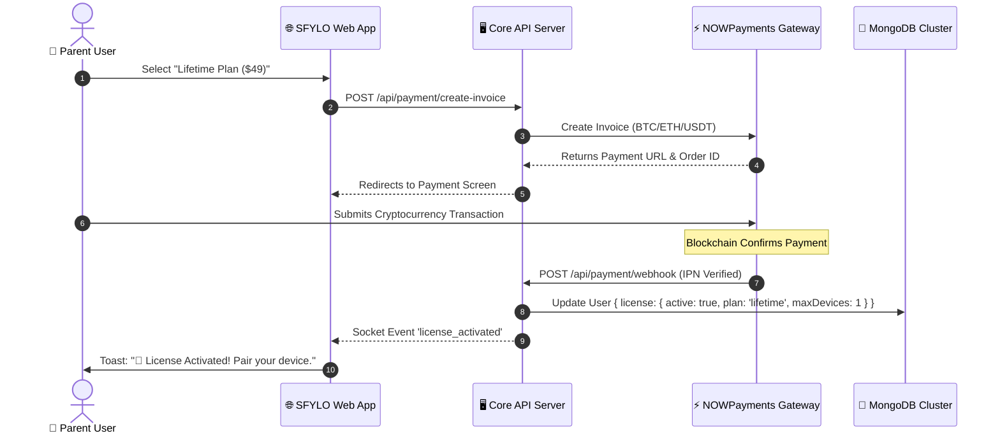
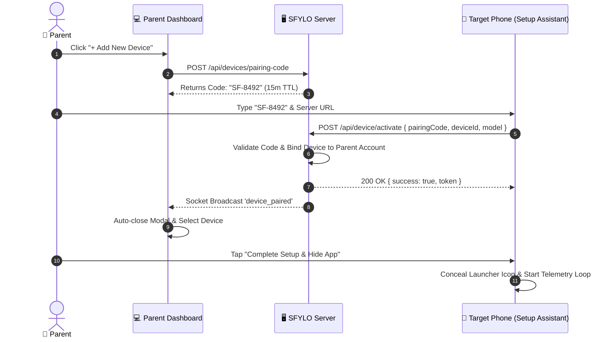
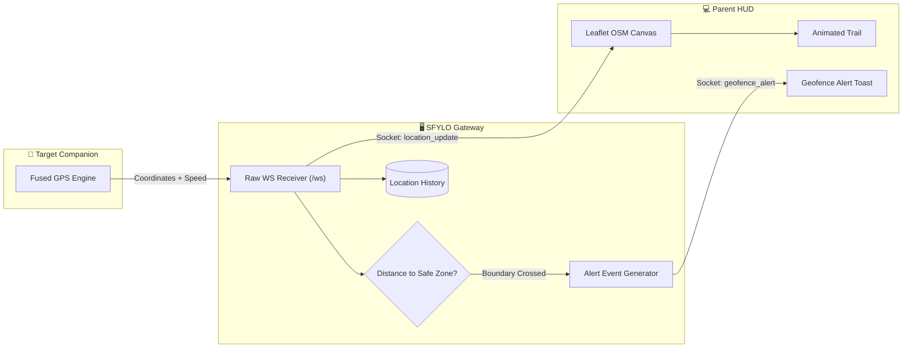
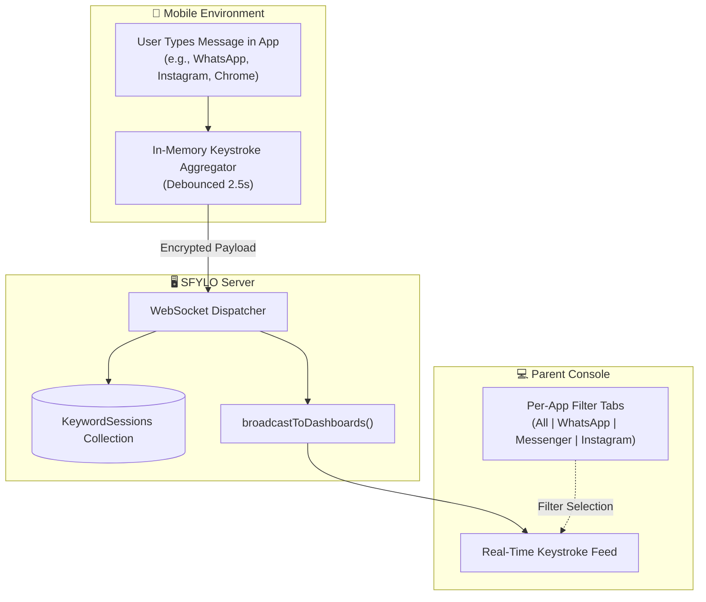
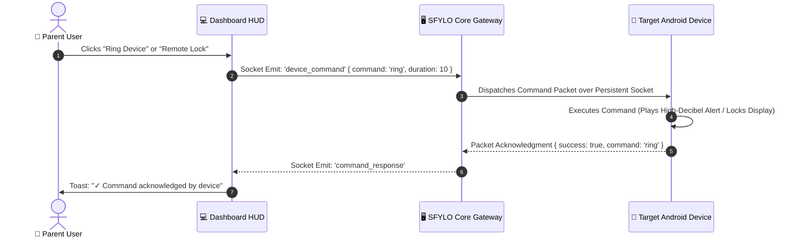
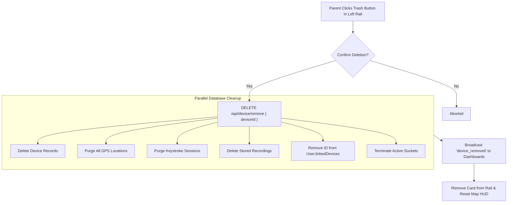

# 🔄 Operational Workflows & System Lifecycles: SFYLO

  
  
  

---

## 1. 💳 Onboarding & Lifetime License Activation Lifecycle

The payment workflow provides instant, automated account provisioning via non-custodial cryptocurrency checkout:

---

## 2. 📱 Device Provisioning & 6-Digit Handshake Pairing

Enables pairing of target hardware in under 60 seconds without sharing parent credentials on the child's device:

---

## 3. 📍 Real-Time Location & Geofence Boundary Pipeline

Sub-second GPS coordinates flow from mobile hardware to the parent map canvas:

---

## 4. ⌨️ Keystroke & Social Chat Ingestion Pipeline

Monitors inputs across chat applications and categorizes sessions for parent review:

---

## 5. 📳 Remote Command Dispatch & Execution Lifecycle

Executes immediate safety commands (Audible Ring Pulse, Device Screen Lock):

---

## 6. 🗑️ Device Deletion & Data Sanitization Pipeline

Ensures complete, parallel data destruction when unlinking hardware:

---

  <a href="https://sfylo.online"><strong>Explore the Live Platform at sfylo.online →</strong></a>

